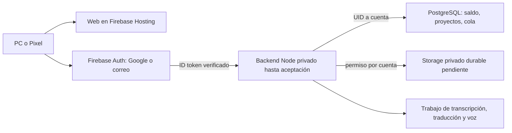

# Vistavo · Inventario de configuración y plan de calidad

Estado vigente al cierre: auditoría ampliada y planB0 completados con DeepSeek/Kimi y revisión final Gemini batch PASSdocumental. BackendB1–B6 no aceptado; Firebasevigente, Supabaseanterior. La información de cuotaDEV/Kimi402 en las secciones iniciales es histórica: recarga ylectura con cuota correcta posteriores la sustituyen. Véanse informe integral y especificación de backendcompleto.

Fecha: 13 de noviembre de 2026. Tarea LV-003/LV-007. Base Git main c435068 con cambios locales previos; este documento no autoriza migración, nuevos recursos ni publicación funcional.

## Inventario inicial · corte histórico, actualizado al final

| Área | Estado acreditado | Pendiente |
|---|---|---|
| Web comercial | Firebase Hosting vistavo-prod; vistavo.app; A3; preview noindex. Versión98a81624fa93bb66. | Conectar backend después de aceptar candidata privada. |
| Login elegido | Firebase Authentication, no Supabase como proveedor vigente. Google y correo/contraseña habilitados por lectura remota13nov. | Recorrido real en dominio final, PC y Pixel; entrega/acción de correos y revocación. |
| Dominios Auth | localhost,127.0.0.1,vistavo.app,www.vistavo.app,vistavo-prod.firebaseapp.com,vistavo-prod.web.app. | Retornos y handler de acciones comprobados, topología de sesión. |
| Datos de aplicación | PostgreSQL17.11 dedicado local15438; cuentas, identidades, saldo, proyectos y cola en servidor Node. | Cloud SQL durable y restauración comprobada; inventario remoto SQL no concluyente403. |
| Cómputo | Código Node24 y preparación Linux/FFmpeg existentes. Run API devuelve403/deshabilitada. | Runtime cloud, activación de trabajos y limpieza persistente. |
| Archivos | PrivateFileStore local; Storage prod enumera0buckets. | Adaptador durable, cargas reanudables, generación/Range/TTL/borrado. |
| Facturación | Billing for Robertson vinculada; billingEnabled=true comprobado. | Coste real de pipeline; límites operativos, alertas y atribución. |
| Supabase | SDK2.119.0 y adaptador anterior conservados; no se detectaron claves de proveedor Supabase en los4archivos inspeccionados; no acredita el entorno de un proceso. | No se acreditó un proyecto alojado de Vistavo. Connector list_projects falla por link_id ausente; no se inspeccionan proyectos ajenos ni se inventa ausencia global. |

La presencia de archivos de entorno no demuestra qué ejecuta un proceso. El estado publicado es frontend estático: no ofrece hoy login funcional, compras ni procesamiento. La autorización de dominios no prueba acceso completo. Una API403 no prueba que no exista un recurso. La lectura SQL inicial menciona proyecto de cuotaADC linguistvision-dev; repetir inventario con proyecto de cuota correcto antes de concluir. Las mediciones locales y pruebas históricas se identifican como tales.

## Login vigente: contrato implementado en código

1. Navegador usa SDK Firebase configurado por /pilot/auth/config/. Alta correo/contraseña y envío de verificación, Google popup con fallback redirect; recuperación con respuesta genérica. La vinculación de proveedores exige credencial de la cuenta existente; no se fusionan cuentas PostgreSQL por correo.
2. Usuario no verificado queda sin acceso de servidor. El cliente envía ID token a POST /pilot/auth/session/.
3. Servidor Admin SDK utiliza ADC local externo o futura identidad administrada. verifyIdToken(token,true), email_verified=true, auth_time reciente<=300s salvo renovación del mismo UID con sesión previa válida; rechaza futuro>60s y tamaño>7000. El SDK fija proyecto/audiencia; probar tokens de otro proyecto explícitamente.
4. firebase_uid se relaciona transaccionalmente con cuenta PostgreSQL mediante commercial_firebase_identities y advisory lock. Probar concurrencia del mismo UID y aislamiento entre UID distintos con mismo correo.
5. Cookie servidor8h, HttpOnly, SameSite=Lax, Path=/pilot/, Secure con HTTPS. verifySessionCookie(token,true) en solicitudes protegidas. POST sesión/logout exigen Origin exacto y JSON. Logout borra cookie de ese navegador; no revoca por sí mismo todas las sesiones de otros dispositivos. No equiparar ambas cosas.
6. Limitador actual30solicitudes de sesión/60s por socket.remoteAddress, máximo1024orígenes, por proceso. No es un limitador distribuido; en Cloud Run el proxy puede agrupar usuarios. No confiar indiscriminadamente en X-Forwarded-For. Definir proxy y controles compartidos antes de exponer backend.

Fuentes: server/commercial/{firebaseAccess.ts,firebaseRoutes.ts,accountAccess.ts,accountAccess.sql,pilotLocal.ts}; server/commercial/web/firebaseAuth.ts. Verificación de correo/recuperación implementada no equivale a entrega real demostrada en producción.

## Supabase anterior: detalle sin presentarlo como servicio activo

- Activación mediante LINGUISTVISION_SUPABASE_URL y LINGUISTVISION_SUPABASE_PUBLISHABLE_KEY, con commercial preview. Se rechaza Firebase+Supabase simultáneos. Esquema propio lv_commercial_auth, con variante sandbox; Firebase usa lv_commercial_firebase_dev y variante sandbox. Separar datos de prueba/producción; no dar estos nombres de desarrollo como esquema cloud final.
- Supabase Auth usa PKCE. Callback de Google del proveedor: https://<proyecto>.supabase.co/auth/v1/callback; retornos de la app /pilot/auth/google/, confirm/, recovery/. Cookies de prueba firmadas con HMAC y verifier; el secreto es por proceso y no sobreviviría múltiples instancias/reinicio. Esto es deuda de un posible retorno a Supabase, no falla del login Firebase vigente.
- El servidor intercambia código, consulta auth.getUser(token) y exige email_confirmed_at y UUID válido. Relaciona user_id con commercial_supabase_identities y cuenta PostgreSQL; sesión opaca8h cuyo digest reside en base local.
- Recuperación: prueba consumible de5min, actualización de contraseña y eliminación de sesiones de esa identidad. Contador global30/min por proceso en rutas antiguas; no está listo para producción distribuida.
- Antecedente GoTrue/Mailpit local e integración con dobles; no acredita SMTP/Google/Supabase alojados hoy. No se ha acreditado Supabase Storage, PostgREST, Edge Functions, RLS o esquema remoto. Si Rob pide migración, se abre decisión separada y comparación antes de crear recursos/cambiar identidades.

Fuentes: server/commercial/{supabaseAccess.ts,supabaseRoutes.ts,accountAccess.ts,accountAccess.sql}; docs/DEPLOYMENT.md sección candidata anterior. Evidencia histórica no sustituye nueva auditoría remota.

## Plan y criterios de cierre

| Paso | Trabajo y responsable | Evidencia obligatoria para cerrar |
|---|---|---|
| Q0 Inventario | Codex lectura remota y de fuentes; DeepSeek propone, Kimi audita, Gemini revisa plan integrado. | Cada afirmación marcada código/config remota/prueba histórica/pendiente. Resolver proyecto Supabase si existe. Listado SQL/Run con cuota correcta y permisos adecuados; no cambiar APIs como efecto de una lectura. |
| Q1 Contrato de producción | Codex concreta un solo proveedor vigente Firebase, esquema cloud nuevo, origen, callback, dominios y secreto/identidad. | Diagrama y matriz entorno→proyecto→datos; ninguna clave privada/credencialcliente privilegiada; identidad de servicio mínima; plan de reversión sin pérdida de UID/saldo. |
| Q2 Login completo | Implementación y auditoría independientes; Codex verifica candidata privada. | PC y Pixel: Google, alta, bloqueo no verificado, verificar/reentrar, recuperar/usar enlace una vez/caducado, salir/reentrar, proveedor enlazado con prueba. Negativos token incorrecto/revocado/caducado/otro proyecto, Origin ajeno, UID mismo correo y accesos cruzados. Distinguir cierre local de revocación global. |
| Q3 Datos/archivos durables | Cloud SQL y Storage sólo dentro de alcance autorizado; adaptación a contratos existentes. | Migración idempotente, backup/restauración a entorno aislado y comparación; reinicio/reapertura; URLs autorizadas, bucket privado, generación, expiración/retención/borrado, carga parcial/duplicada/reanudada, aislamiento por cuenta. No montar bucket como POSIX. |
| Q4 Cola/coste/saldo | Conservar PostgreSQL claim/lease/SKIP LOCKED; activar trabajos/limpieza fuera de timers efímeros. | Reentrega tras crash, un único débito/reserva, fallo libera, resultado ambiguo UNKNOWN sin retry remoto automático; compra duplicada, webhook ajeno, aislamiento. Medir IA/cómputo/SQL/storage/egress/logs y alertas sin tratarlas como corte automático. |
| Q5 Video y calidad | Fixtures sintéticos120/180s español→inglés, TXT/SRT y voces Kore/Charon. | Rúbrica previa nombres/medidas/sentido/tiempos, muestras bilingües y escucha humana; memoria/duración/coste por resultado y fallos. MP4voz depende LV-016.D: no declarar completo mientras falte.10min después de3min aceptados. |
| Q6 Salida controlada | Codex entrega candidata privada y evidencia; Rob conserva aceptación comercial/publicación. | Tipos, suite significativa sin omisiones,2builds, HTTPS/headers, accesibilidad PC/móvil/RTL, permisos, backup/rollback y recorrido final. Native review, legales/soporte/precios, Drive como gate propio. Retirar preview/noindex sólo con alcance aprobado y funciones demostradas. |

No se fija plazo ni cifra mensual sin datos. Mantener actualizaciones de costes, pruebas negativas, informe completo de cada revisor y discrepancias resueltas por código. Un PASS documental sólo acepta el plan revisable; ningún modelo certifica servicios no probados.

## Fuentes y evidencia

- outputs/vistavo-config-quality/inventory.json (lecturas actuales sin valores secretos).
- outputs/vistavo-a3-publish/{release-proof,domain-http,acceptance}.json y outputs/vistavo-billing-approved/verification.json (publicación y billing).
- docs/FIREBASE-VISTAVO-2026-11-12.md; docs/specs/LV-007-vistavo-google-cloud.md; docs/specs/LV-016-C-voz.md.
- Sesiones Firebase: https://firebase.google.com/docs/auth/admin/manage-cookies .
- Batch: https://openrouter.ai/docs/batch-quickstart . Catálogo actual confirma google/gemini-4-hydrogen:batch; enviar al endpoint batch con slugbase según documentación, no sustituir silenciosamente por llamada síncrona.

Estado: borrador de Codex para contraste T3; Kimi HTTP402 por reserva automática de131072tokens superior al saldo, autorización para limitar salida o recarga pendiente. Sin nueva configuración de recursos o aplicación.

## Recorrido previsto y controles

El diagrama mezcla componentes existentes y destino: las etiquetas pendientes son gates abiertos. Hoy Hosting público no tiene enlazado el backend. Supabase no participa en este recorrido vigente.

## Contraste de DeepSeek e integración de Codex
DeepSeek PASS documental condicionado a las correcciones, informe completo leído. Se adoptan: citar acceptance.json para el alcance público; ampliar Q2 con cookie manipulada; medir límite readJson; sello Q2–Q6 NO ACEPTADOS funcionalmente hasta evidencia propia. No se adopta como ausencia de código lo que faltaba en sus fragmentos: accountAccess.ts sí tiene advisory lock y commercialSessionSeconds=8h, comprobados por Codex. No se adopta como ausencia de pruebas la falta de nuevas pruebas aportadas al revisor: hay antecedentes y306tests históricos, sin ejecución nueva en esta fase documental.
Q0 adicional: comprobar PeerLoginLimiter ventana/capacidad y límite del lectorJSON antes de candidata cloud. PKCE confirm/recovery del adaptador Supabase requiere evidencia de los enlaces del proveedor real si se reactiva; no sustituir por verifyOtp sin contrato demostrado. Repetición SQL/Run con header de cuota vistavo-prod siguió403; se conserva mensaje SQL que menciona linguistvision-dev, sin activar APIs ni alterarADC global. Evidencia quota-project-check.json.
Q2–Q6: NO ACEPTADOS como implementación cloud. Este informe y los dictámenes sólo pueden cerrar la preparación documental. Kimi continúa sin informe porHTTP402; no hay T3completo. La siguiente revisión Gemini recibirá esta limitación explícita.

## Estado que sustituye las notas iniciales · auditoría ampliada

Rob amplió el alcance a todo el backend y al MASTERPLAN. Tras recarga se ejecutó Kimi sin tope; el rechazo402 original se conserva y ya no bloquea sus revisiones ampliadas. La primera revisión Gemini batch terminó INCONCLUYENTE sobre el alcance inicial; no cubre la ampliación. El detalle vigente está en LV-007-backend-completo-firebase.md y el registro de hallazgos.

Lectura correcta backend-remote.json: ADC sin cambio global, token en memoria y proyecto de cuota vistavo-prod; ServiceUsage confirma APIs SQL Admin/Run deshabilitadas. No insistir en una ambigüedad ya aclarada ni activarAPIs como efecto de lectura.

Corrección de la auditoría inicial sobre JSON: pilotHttp crea FirebaseRoutes con req=>jsonBody(req,8192), no el default4096. Además su handler exterior captura RequestError y devuelve400/413. No se adopta el supuesto fallo no controlado de readJson sólo porque está fuera del try interior. Mantener negativos HTTP como gate, sin modificar código por ese falso positivo.

Q0/B0 entrega documental en auditoría; Q1–Q6/B1–B6 siguen SIN ACEPTACIÓN FUNCIONAL cloud. Firebase vigente y Supabase legacy separados. No se solicita migrar a Supabase; Rob aclaró que el destino es Firebase/Google Cloud. Los registros anteriores son cortes históricos con contexto limitado.
